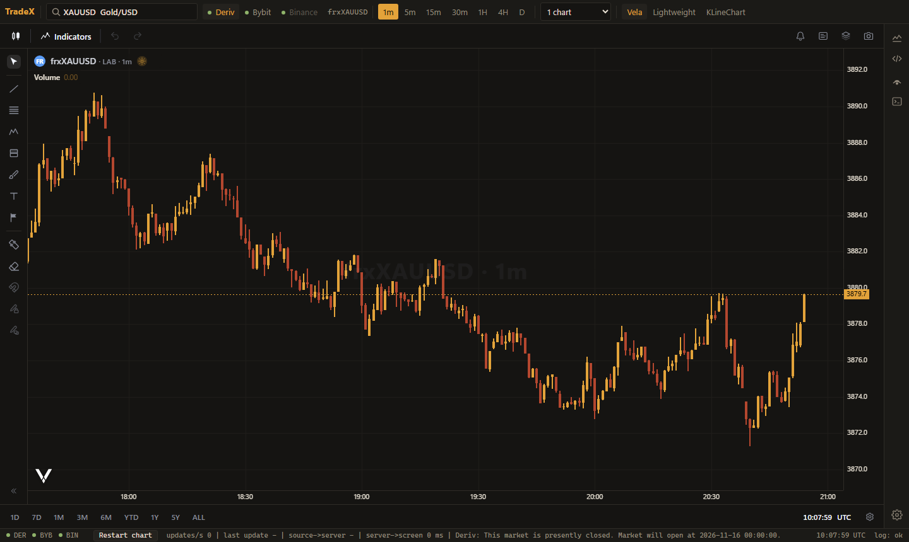
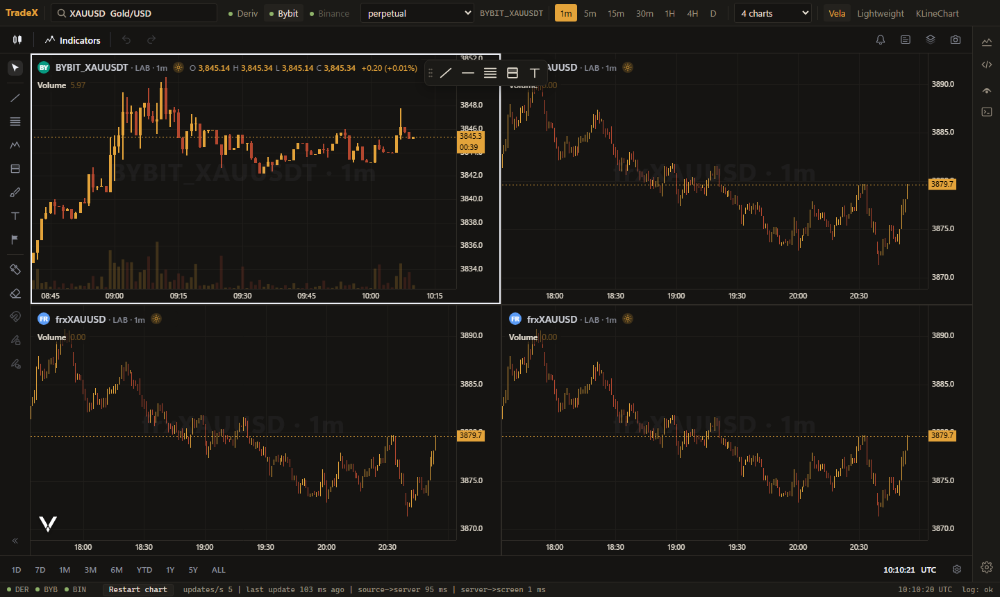
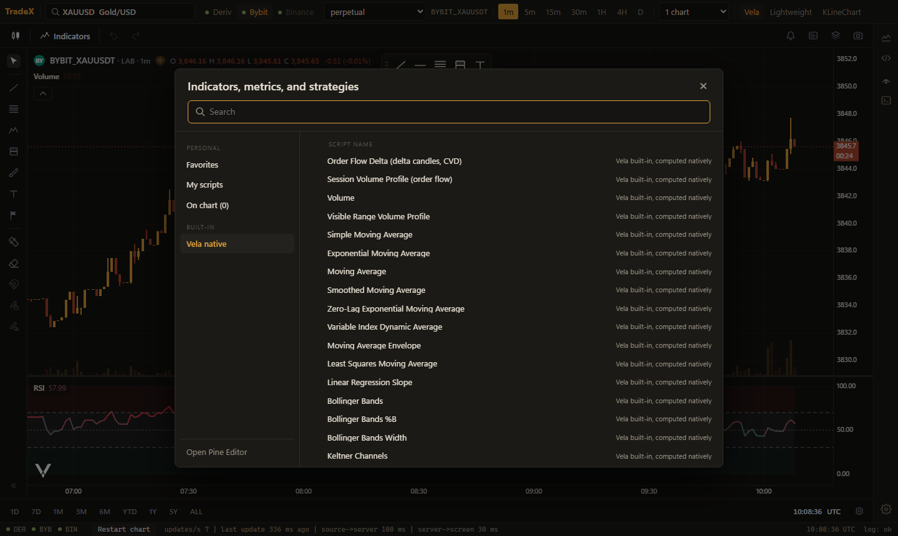
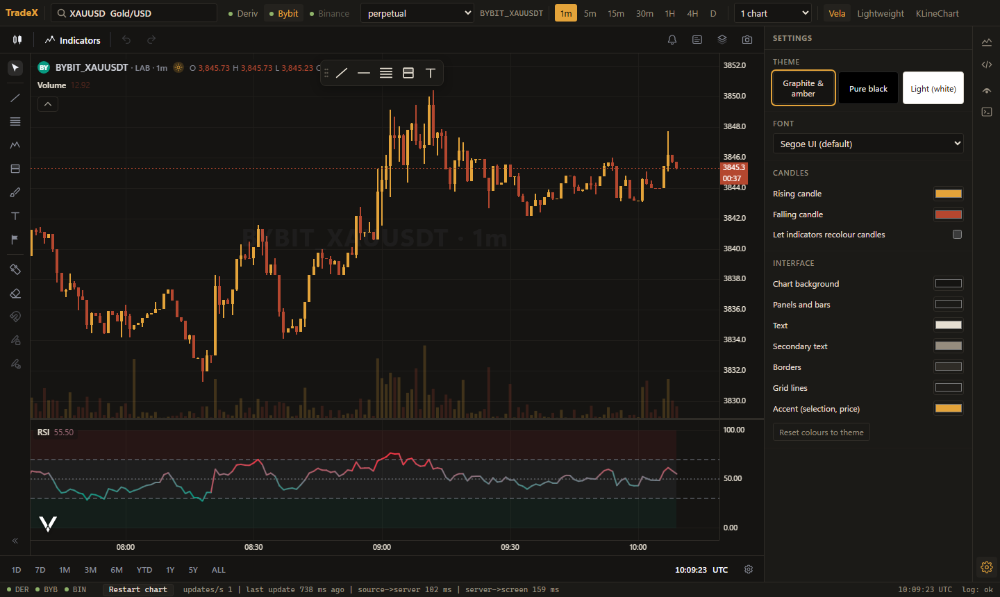
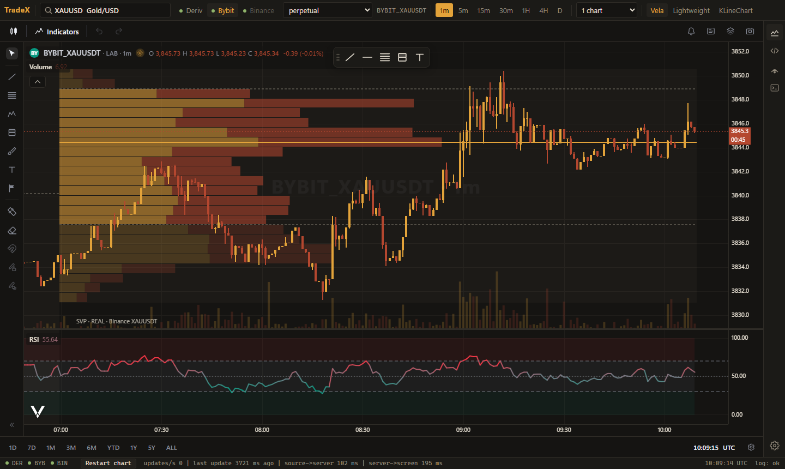
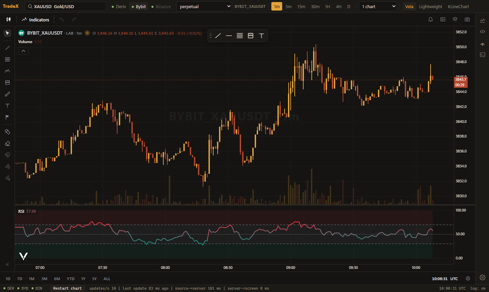
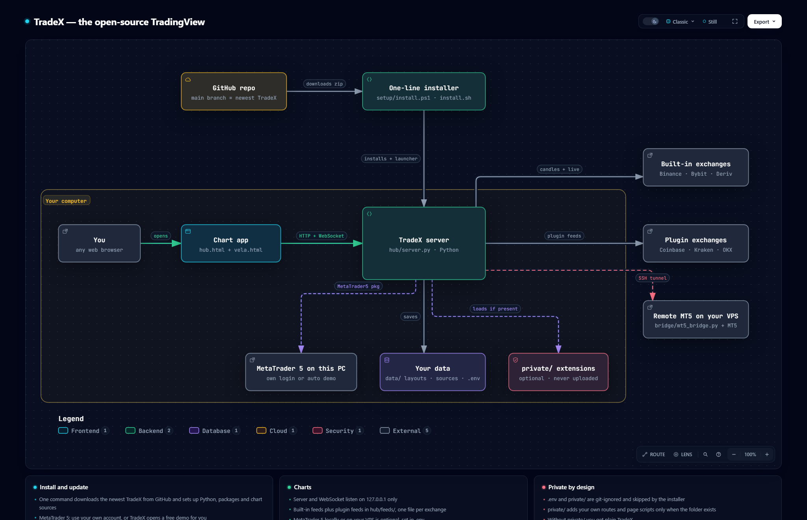

# TradeX (The Open Source TradingView)

TradeX is a free, self-hosted, TradingView-style charting app that runs on your own computer.
It puts one interface over several free market-data feeds and the Vela chart engine. It runs Pine Script
indicators and can also show candles from your own MetaTrader 5 terminal, on this PC or on a VPS.

**Try it in your browser, nothing to install:** [tradex.pages.dev](https://tradex.pages.dev) (web beta:
free exchange charts, indicators, Pine Script, order flow (delta, volume profile), layouts saved in your browser. MT5 and alerts need the
free desktop version below.)

> Not affiliated with, endorsed by, or connected to TradingView, Inc. "TradingView" is their trademark.
> This project is an independent open-source tool. It is not financial advice.
> Also not affiliated with [TradeX Chart](https://github.com/tradex-app/TradeX-chart) (the `tradex-chart` library),
> a separate project with a similar name.
>
> **Official TradeX** is only this repository and [tradex.pages.dev](https://tradex.pages.dev). Forks are welcome under
> their own name and logo: see [TRADEMARK.md](TRADEMARK.md).



| Four synced charts + favourite drawing tools | Indicators dialog |
|---|---|
|  |  |
| **Themes, fonts and candle colours** | |
|  | |
| **Order flow: session volume profile (real Binance trades)** | **Floating favourite-tools bar** |
|  |  |

## What it does

- **Free feeds, no account needed:** Deriv (forex, gold, indices, crypto), Bybit (about 3,300 crypto
  and metal markets) and Binance (crypto). They work out of the box.
- **Your own MetaTrader 5 (optional):**
  - **Local MT5:** a terminal on this Windows PC (any broker).
  - **Remote MT5:** a terminal on a VPS or cloud server, reached through an SSH tunnel and a small bridge
    (`bridge/mt5_bridge.py`). The bridge only reads candles. It never places orders.
- **The broker switch keeps the instrument.** Gold stays gold when you move from Deriv to Bybit to MT5.
  Only exact matches are joined, so gold tokens such as PAXG are kept separate from gold spot.
- **Vela chart engine:** Pine Script, native indicators, drawing tools and layouts of up to 8 synced charts.
- **Timeframes and locale:** weekly and monthly candles are aggregated from each feed’s daily bars using Monday-start weeks and calendar months (UTC calendar dates). History depth depends on the source. Order-flow footprint, delta and session volume profile do not support these two timeframes. The main interface defaults to Turkish and the chart timezone to Europe/Istanbul; saved layouts may retain their chosen timezone. Some custom plugins and feed messages remain in English.
- **Deep history:** Vela loads 10,000 candles per chart (more in chart settings > Advanced), and fills any gap
  left by sleep or a reconnect before the next live candle.
- **Favourite drawing tools:** star a tool in the drawing toolbar and it appears on a small floating bar over the
  chart, like TradingView. Drag the bar by its grip, double-click the grip to turn it vertical. Stars and position
  are remembered.
- **Order flow (Vela chart types):** volume footprint, session volume profile and TPO, plus a delta indicator.
  Crypto and gold use real Binance futures trades with the buyer/seller side; other symbols get a labelled
  estimate from the chart's own candles. Deriv candles have no volume, so use Bybit, Binance or MT5 for order flow.
- **Pine Script:** write or import your own scripts in the Pine Editor. Scripts written for v1 to v4 are
  converted to v5 automatically and the original is kept. Converted values are not verified
  against any reference yet, so check them before you rely on them.
- **Backend log panel:** one live, redacted view of every feed: reconnects, lag, silent streams.
- **Safe by default:** binds to `127.0.0.1` only and serves only a whitelist of static files. With nothing
  configured, it never opens an SSH link.

## Architecture

How TradeX fits together: the one-line installer pulls the newest version from this repo, the chart app in your
browser talks only to the TradeX server on your own computer, and the server fetches candles from the exchanges and
(optionally) your MetaTrader 5. Your data, `.env` and `private/` never leave your computer.



Interactive version (zoom, follow a route, light/dark): download
[`docs/architecture/tradex-architecture.html`](docs/architecture/tradex-architecture.html) and open it in a browser.
Source of the diagram: [`docs/architecture/tradex-architecture.json`](docs/architecture/tradex-architecture.json).

## Install in one line

No Python, no admin rights and no account needed. Everything goes into one folder (`D:\TradeX` when drive D: has
room, else your user folder; `~/TradeX` on macOS/Linux).

New to this? Follow the picture guide: **[How to install TradeX (no coding needed)](docs/WALKTHROUGH.md)**.

**Windows** (PowerShell):
```powershell
powershell -ExecutionPolicy Bypass -c "irm https://github.com/saifullahshafin/open-source-tradingview/releases/latest/download/install.ps1 | iex"
```
**macOS / Linux** (Terminal):
```sh
curl -LsSf https://github.com/saifullahshafin/open-source-tradingview/releases/latest/download/install.sh | sh
```
Then start **TradeX** from the Start menu (Windows) or run `~/TradeX/tradex.sh`. Your browser opens the charts.

**Update:** run the same line again. It downloads the newest TradeX and keeps your layouts, settings and data.

| What if... | TradeX does |
|---|---|
| you have no Python | the installer brings its own (via uv), inside the TradeX folder |
| you have never used MetaTrader 5 | choose "Create a free demo account for me": TradeX opens one by itself (nothing to type) |
| you have an MT5 account | choose "I have an MT5 account" and type login number, server and password (best: the read-only investor password; never saved by TradeX) |
| you do not want MetaTrader 5 | choose "Skip"; the free exchanges still work |
| you already have MetaTrader 5 installed | TradeX installs its own portable copy in its folder and leaves yours alone |
| an exchange is blocked in your country | setup tests each exchange and switches on only the ones that answer |
| port 8770 is taken | TradeX says so at start; set `HUB_HTTP_PORT` in `.env` |
| the internet drops halfway | run the line again; it continues from the step that failed |
| you are on macOS or Linux | all free exchanges work; MetaTrader 5 charts are Windows-only for now |

## Quick start (manual, for developers)

Requirements: Python 3 (tested on 3.14). Node.js is not needed to run it; the built bundle is included.

```bash
git clone https://github.com/saifullahshafin/open-source-tradingview.git
cd open-source-tradingview
python -m venv .venv
# Windows: .venv\Scripts\activate      macOS/Linux: source .venv/bin/activate
pip install -r requirements.txt
cp .env.example .env        # optional: only needed for MT5
python hub/server.py
```

Then open <http://localhost:8770/hub.html>. On Windows you can double-click `start.bat` instead.

### Candle appearance and watchlist

Open **Settings** (gear on the right) to set rising/falling body, border and wick colours, toggle each part, and
choose wick thickness. Wick thickness is supported by the Vela engine.
Settings are saved in the browser. The chart's display labels use the market name and the actual feed name; the
internal ticker used to request data is unchanged.

The **İzleme listesi** button on the right opens the watchlist (open by default on wider screens). Use **+ Grafik**
to add the current market or **+ Ara** to search. Choose an entry to open its exact source and market, or remove it
with ×. The list is saved in the browser, not synced between devices. Prices and percentage changes use the latest
available daily candles, refreshed approximately once per minute while the panel is open; feeds may be delayed or
unavailable, in which case the row shows a dash rather than a price.

## Borsa İstanbul shares

The desktop hub includes a BIST source using Yahoo Finance's unofficial, delayed reference prices; availability,
latency, history and usage are subject to Yahoo's coverage and terms. Search for a ticker such as `THYAO` and select
**BIST (Borsa İstanbul)**. The web beta can use BIST only if its optional Cloudflare Pages Function is deployed;
Yahoo does not provide browser CORS. See [web beta setup](docs/WEB_BETA.md#optional-bist-support-on-mobile-and-desktop-browsers).
The built-in search list contains a 2023 snapshot of more than 500 symbols plus some extra names; it can contain
renamed or delisted companies, and a search result does **not** mean Yahoo currently has candles for it. It is not
an exhaustive or up-to-date BIST listing. Yahoo VIOP symbols in this plugin may not exist or return data; BIST indices
and reliable VIOP coverage are not provided by this list.

To add missing share codes, create `data/bist_symbols.csv` (or `bist_symbols.csv` in `TRADEX_DATA` if configured)
in UTF-8, one code and optional name per line, then restart the hub. Examples:

```csv
symbol,name
THYAO,Türk Hava Yolları
EXAMPLE,Example company
```

The optional `.IS` suffix is accepted; entries are looked up on Yahoo as `<code>.IS`. Adding a code does not verify
that it exists or that data is available. `data/` is local and is not committed. If BIST was disabled by setup after
a failed connection test, set `"bist": true` in `data/sources.json` (or the `TRADEX_DATA` equivalent) and restart;
this does not bypass connectivity or Yahoo restrictions.

## Connect MetaTrader 5 (optional)

**MT5 on this Windows PC:** install MetaTrader 5, log in to your account, then run `pip install MetaTrader5`
and set `LOCAL_MT5=1` in `.env`. A "Local MT5" feed appears.

**MT5 on a VPS or server:** step-by-step instructions are in [AGENTS.md](AGENTS.md#remote-mt5-on-a-vps). In short:
1. On the server: run MT5, enable its MCP server (Tools > Options), then start
   `MT5_MCP_TOKEN=... python3 bridge/mt5_bridge.py`. It listens on `127.0.0.1:8797` only.
2. On your PC: add the server to `~/.ssh/config` (key login) and set `REMOTE_MT5_SSH_HOST=<alias>` in `.env`.
3. Restart the hub. It opens the SSH tunnel itself and reconnects if the link drops. A "Remote MT5" feed appears.

## Let your AI agent set it up

[AGENTS.md](AGENTS.md) is written for coding agents (Claude Code, Codex, Cursor and similar). It gives the exact
install, run and check steps for every setup (free feeds, local MT5, VPS MT5), the expected outputs, and the
security rules. Point your agent at it: *"Read AGENTS.md and set this up for me."*

## Project layout

```
hub/        the app: server.py (data + web server), hub.html (the shell), engine pages, Pine tools
bridge/     mt5_bridge.py: read-only candle bridge for a remote MT5 terminal
build/      source and build script for hub/vela.bundle.js (npm)
docs/       screenshots
licenses/   third-party licence and notice files
NOTICE      copyright and the two extra AGPL terms (attribution, no trademark rights)
```

## Roadmap

- Price and Pine alerts (built privately, not yet ported to run without a server)
- Accuracy tests: candles against the broker, Pine values against reference values

## Licence

**AGPL-3.0-only** (see [LICENSE](LICENSE)), because the bundled Pine Script engine
([PineTS](https://github.com/LuxAlgo/PineTS) and [Vela-pinets](https://github.com/LuxAlgo/Vela-pinets)) is AGPL-3.0. If you run a
modified version for other people over a network, you must offer them its source.
Third-party parts keep their own licences. See [THIRD_PARTY_NOTICES.md](THIRD_PARTY_NOTICES.md).
Market data belongs to its providers. Check each feed's terms before any public or commercial use.

Copyright (C) 2026 Saifullah Shafin. [NOTICE](NOTICE) adds two terms allowed by AGPL section 7, for TradeX's own
code only: keep the line "Based on TradeX by Saifullah Shafin" wherever your version shows its legal notices, and
no right to the TradeX name or logo.

## Name and logo

The TradeX X logo and "TradeX"™ as the name of this software are trademarks of Saifullah Shafin. You may fork and
change the code, but a version you share or host needs its own name and logo. Details: [TRADEMARK.md](TRADEMARK.md).

## Contributing

Pull requests are welcome. Read [CONTRIBUTING.md](CONTRIBUTING.md) first: commits are signed off (`git commit -s`)
and contributions are accepted under its terms.
